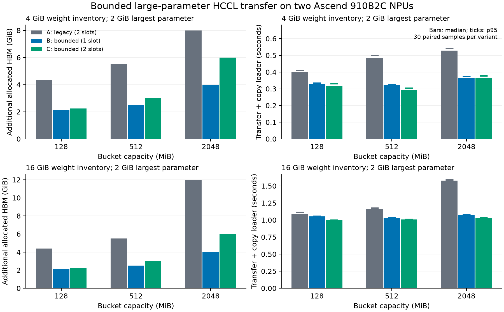
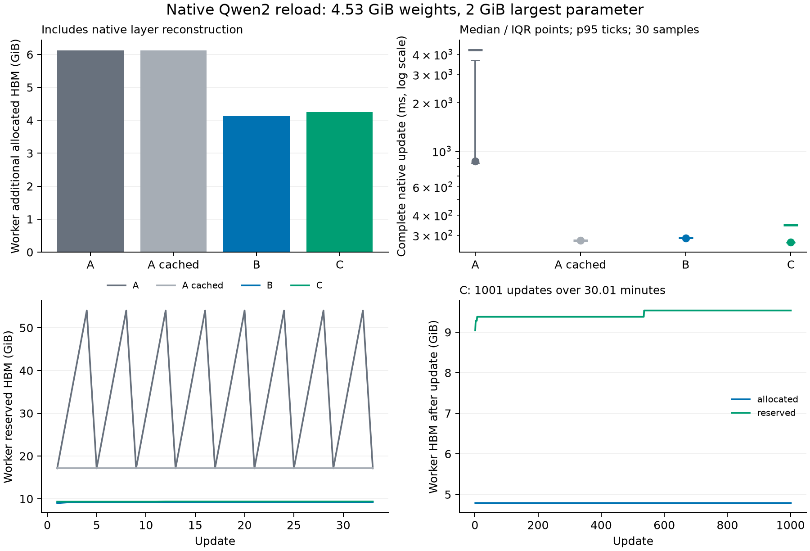

# 有界大参数 HCCL 权重更新：910B 实验报告

原生 Qwen2（约 4.53 GiB 权重、2 GiB 最大参数）的双缓冲有界更新，将 Worker 额外 allocated 峰值从 6.125 GiB 降至 4.250 GiB，下降 30.6%。完整参数字节和更新后推理与独立冷加载一致。

4 GiB 权重库存、2 GiB 最大参数、128 MiB 桶下，双缓冲有界传输将接收端传输临时 allocated 峰值从 4.375 GiB 降至 2.250 GiB，下降 48.6%。进程内分配预算实验中，基线在 2432 MiB 额外余量下 OOM，双缓冲模式连续完成 10 次更新。

原生 Qwen2 更新完成 1001 次，持续 1800.33 秒；最终全部参数字节、确定性推理结果与独立冷加载一致，参数地址保持不变。

## 环境与启动

| 项目 | 实际配置 |
| --- | --- |
| NPU / 驱动 | 4 × Ascend 910B2C，64 GiB/卡；26.1.1 |
| 物理卡 / 逻辑卡 | 1、5、12、15 / 0、1、2、3 |
| Python | 3.12.16 |
| PyTorch / torch_npu | 2.10.0+cpu / 2.10.0.post4 |
| CANN / NNAL | 9.2.1 / ATB 9.2.1，ABI 1 |
| 算子 | 910B 9.2.1；固定 A2 配方的 ops-transformer 9.3.0 包 |
| Triton / FLA | Triton Ascend 3.2.2；FLA NPU A2 26.9.1 |
| NumPy / OpenCV | 1.26.4 / opencv-python-headless 4.11.0.86 |
| Ascend 源码 | `24a76e84394ae3427195e3715fc08e90769d398c` |
| vLLM 源码 | `544f182d9f0c9bfe8bd7645525951d5e3692a542` |

NumPy 保持 Triton Ascend 要求的 1.26.4，OpenCV 使用兼容该 NumPy 的 4.11.0.86。所有 A/B/C 方案共用同一环境。完整依赖见 [installed-requirements.txt](installed-requirements.txt)，源码及公平基线见 [source-versions.json](source-versions.json)。

软件安装在任务目录的 `.venv-ascend`、`.runtime/Ascend` 中，原系统 Python、CANN 和宿主驱动保持原配置。NPU 张量、事件、两进程 HCCL、标准 EngineArgs/Worker 启动及真实权重更新均通过。每项硬件作业由 coordinator 检查健康和空闲状态后运行；已知 keepalive 控制器在作业期间暂停，结束后恢复。

两卡矩阵使用物理 1/5 的 HCCS 域；跨域字节检查使用 1/12。TP=2 和四卡作业设置 `HCCL_INTRA_PCIE_ENABLE=0 HCCL_INTRA_ROCE_ENABLE=1`，适配本机跨模组拓扑。

## 实现与内存归属

`packed_transfer_mode="bounded"` 在初始化时固定；默认仍为 `legacy`。双方使用相同的参数元数据生成字节分片，每次 collective 不超过桶容量。源参数必须是当前 NPU 上连续的非量化 ND/NCHW 张量。接收端独立分配完整参数存储，再调用原生 `load_weights()`；加载器可保留或修改输入。会话内复用 NPU stream，使 allocator 能跨更新复用存储。

设更新总字节数为 S、桶容量为 B、槽数为 K、最大参数为 Lmax。实际槽容量 C=min(B,S)，重组及待加载完整参数的预算 R=Lmax+K(B−C)。新参数分配前，若完整待加载参数 P 与新参数 W 满足 P+W>R，则先消费并释放 P。因此传输侧持有的张量存储满足 K×C+P+W≤K×B+Lmax；同时最多一个参数尚未完成重组。

| 内存类别 | 计量方法 | 是否计入传输上界 |
| --- | --- | --- |
| 通信槽、重组及待消费参数 | 规划/调度单测的存储生命周期；实际 allocated 增量 | 是 |
| 源权重、模型参数、KV cache | 更新前 allocated、模型参数总字节数 | 否 |
| 加载器保留的输入 | 原生 layerwise 缓存中的独立存储 | 否；与传输仍持有的输入可能共享存储 |
| 原生层重建 | materialize_layer 前后 allocated 与层张量字节数 | 否 |
| 运行库 / allocator | reserved、设备剩余内存、进程 RSS | 否 |

原生加载器归属测量与 Profiler 独立运行，不进入延迟统计：

| 方案 | 最大层重建 allocated (MiB) | 回调结束后最大保留输入 (MiB) | FINISH 后保留输入 (bytes) |
| --- | ---: | ---: | ---: |
| A | 2048.000 | 64.000 | 0 |
| B | 2048.000 | 0.000 | 0 |
| C | 2048.000 | 0.000 | 0 |

## 内存与延迟矩阵

A 为固定上游加 #19127 指定 head 的正确性基线；B 为单缓冲有界模式；C 为双缓冲有界模式。基线补丁独立保存在 [lifecycle-baseline.patch](lifecycle-baseline.patch)，不包含在功能投稿补丁中。

内存放大的直接反例：128 MiB 配置下，A 的最大实际 collective 为 2048.000 MiB；C 的最大 collective 为 128.000 MiB。接收端还需独立 owning 输入，因此配置桶容量本身不构成旧实现的存储上界。

下表使用预分配 copy loader：每轮改变全部源字节，接收端清零，传输后逐字节验证。计时包含所有 rank 的传输和加载完成，不包含源准备、验证和 Profiler。每配置先预热三轮，再以 ABC/BCA/CAB 平衡轮换取得每方案 30 个正式样本。单位 MiB；耗时为中位数 / IQR / p95，单位 ms。

| 库存 GiB | 桶 MiB | 最大参数 MiB | 方案 | 接收端临时 allocated MiB | 耗时 median / IQR / p95 ms |
| ---: | ---: | ---: | --- | ---: | --- |
| 4 | 128 | 2048 | A | 4480.003 | 401.31 / 7.93 / 409.65 |
| 4 | 128 | 2048 | B | 2176.016 | 329.78 / 4.11 / 334.82 |
| 4 | 128 | 2048 | C | 2304.017 | 315.19 / 3.98 / 331.12 |
| 4 | 512 | 2048 | A | 5632.003 | 484.62 / 7.66 / 500.17 |
| 4 | 512 | 2048 | B | 2560.004 | 322.36 / 2.24 / 326.25 |
| 4 | 512 | 2048 | C | 3072.005 | 291.08 / 4.92 / 303.59 |
| 4 | 2048 | 2048 | A | 8192.002 | 528.56 / 6.69 / 541.12 |
| 4 | 2048 | 2048 | B | 4096.001 | 366.41 / 4.43 / 374.42 |
| 4 | 2048 | 2048 | C | 6144.002 | 362.60 / 4.30 / 377.87 |
| 16 | 128 | 2048 | A | 4480.003 | 1085.61 / 7.59 / 1114.53 |
| 16 | 128 | 2048 | B | 2176.016 | 1052.15 / 6.41 / 1057.17 |
| 16 | 128 | 2048 | C | 2304.017 | 995.72 / 3.73 / 1001.80 |
| 16 | 512 | 2048 | A | 5632.003 | 1161.48 / 8.24 / 1176.50 |
| 16 | 512 | 2048 | B | 2560.004 | 1031.94 / 5.49 / 1042.60 |
| 16 | 512 | 2048 | C | 3072.005 | 1006.63 / 4.38 / 1011.26 |
| 16 | 2048 | 2048 | A | 12288.004 | 1577.45 / 11.68 / 1591.23 |
| 16 | 2048 | 2048 | B | 4096.001 | 1072.92 / 4.29 / 1081.40 |
| 16 | 2048 | 2048 | C | 6144.002 | 1033.79 / 4.33 / 1042.64 |
| 4 | 128 | 64 | A | 768.004 | 273.44 / 3.01 / 281.15 |
| 4 | 128 | 64 | B | 192.001 | 240.62 / 0.87 / 242.98 |
| 4 | 128 | 64 | C | 320.001 | 228.58 / 0.57 / 230.75 |



配对 bootstrap 使用同一轮的方案配对，重采样 10,000 次：

| 库存 GiB / 桶 MiB / 最大参数 MiB | 方案 | 中位数延迟变化 | 95% 区间 |
| --- | --- | ---: | --- |
| 4/128/2048 | B | -17.8% | [-18.6%, -17.0%] |
| 4/128/2048 | C | -21.5% | [-22.2%, -20.3%] |
| 4/512/2048 | B | -33.5% | [-33.7%, -33.2%] |
| 4/512/2048 | C | -39.9% | [-40.2%, -39.6%] |
| 4/2048/2048 | B | -30.7% | [-30.8%, -30.0%] |
| 4/2048/2048 | C | -31.4% | [-31.6%, -30.9%] |
| 16/128/2048 | B | -3.1% | [-3.5%, -2.8%] |
| 16/128/2048 | C | -8.3% | [-8.7%, -8.0%] |
| 16/512/2048 | B | -11.2% | [-11.3%, -10.7%] |
| 16/512/2048 | C | -13.3% | [-13.4%, -13.0%] |
| 16/2048/2048 | B | -32.0% | [-32.2%, -31.8%] |
| 16/2048/2048 | C | -34.5% | [-34.7%, -34.2%] |
| 4/128/64 | B | -12.0% | [-12.6%, -11.8%] |
| 4/128/64 | C | -16.4% | [-17.0%, -16.2%] |

128 MiB 桶、2 GiB 最大参数的接收端内存明细。allocated 基数取正式样本中位数，其余取正式样本最大值；设备剩余内存变化包括 allocator cache，不能当作传输张量存储：

| 库存 GiB | 方案 | 更新前 allocated GiB | reserved 峰值 GiB | 设备空闲量下降 GiB | CPU RSS 峰值 GiB |
| ---: | --- | ---: | ---: | ---: | ---: |
| 4 | A | 4.000 | 8.830 | 4.766 | 1.428 |
| 4 | B | 4.000 | 6.193 | 2.130 | 1.428 |
| 4 | C | 4.000 | 6.320 | 2.256 | 1.427 |
| 16 | A | 16.000 | 21.205 | 4.766 | 1.442 |
| 16 | B | 16.000 | 18.568 | 2.130 | 1.442 |
| 16 | C | 16.000 | 18.695 | 2.257 | 1.442 |

## 最低可运行余量

在接收进程内设置 allocator 分配上限，模型库存已预分配；预算仅限制该进程，不消耗其他卡上的资源。每次成功均检查全部字节，失败必须是实际 allocation OOM。边界分辨率为 128 MiB。

| 方案 | 额外余量 MiB | 结果 |
| --- | ---: | --- |
| A | 2432 | OOM |
| C | 2432 | 连续 10 次成功 |
| C | 2304 | OOM |
| B | 2176 | OOM |
| B | 2304 | 连续 10 次成功 |
| A | 4480 | OOM |
| A | 4608 | 连续 10 次成功 |

原生大 Qwen2 使用相同 5120 MiB Worker 额外分配预算，覆盖完整 START→UPDATE→FINISH 事务：

| 方案 | 额外余量 MiB | 结果 |
| --- | ---: | --- |
| A | 5120 | allocation OOM |
| C | 5120 | 连续 10 次成功，末轮完整参数及冷推理一致 |

四卡扩展使用一个发送根和三个接收 rank，4 GiB 库存、2 GiB 最大参数、128 MiB 桶，三轮预热加每方案 30 个平衡样本：

| 方案 | 接收端最大临时 allocated MiB | median / IQR / p95 ms |
| --- | ---: | --- |
| A | 4480.003 | 497.39 / 7.82 / 504.84 |
| B | 2176.016 | 419.75 / 3.92 / 430.35 |
| C | 2304.017 | 400.96 / 3.39 / 405.94 |

独立 Profiler 的接收 rank 区间测量（4 GiB 库存、128 MiB 桶）：

| 方案 | HCCL 事件数 | TensorMove 拷贝数 | 拷贝时间 ms | 与 HCCL 事件重合 ms | 拷贝时间重合比例 |
| --- | ---: | ---: | ---: | ---: | ---: |
| A | 12 | 66 | 16.338 | 10.588 | 64.8% |
| B | 32 | 81 | 14.227 | 0.000 | 0.0% |
| C | 32 | 81 | 16.744 | 12.599 | 75.2% |

HCCL 事件区间可能包含等待时间；该表说明调度区间重叠，不直接等同于通信带宽利用率。所有 Profiler 样本独立于正式延迟统计。原始 trace 和 kernel CSV 位于 `profiler/`，汇总见 [profile-summary.json](profile-summary.json)。

## 原生模型与持续更新

原生测试使用标准 LLM/Worker、HCCL trainer 和 START→UPDATE→FINISH 事务。TP=1 使用一个 sender 加一个 worker；TP=2 使用一个 sender 加两个 worker。检查完整参数集合、每个 TP 切片的原始字节、更新前后参数地址，以及独立冷加载的 token 和 logprob。

独立功能补丁在未叠加 #19127 的固定上游上通过 199 项 CPU 测试；公平对照分支通过 204 项。新增两卡 E2E 的单/双缓冲 × eager/ACL graph 四个组合全部通过，每个组合执行三次变化权重的更新及独立冷加载对照。仓库完整格式检查通过。
TP=2 另以 8 KiB 桶、单/双缓冲、ACL graph 连续更新三轮，最大源参数跨 16 个分片，完整 TP 切片和独立冷加载推理一致。

小模型为两层 Qwen2（vocab=512、hidden=128）；大模型为两层 Qwen2（vocab=262144、hidden=4096），约 4.53 GiB 权重，embedding 和 lm_head 各 2 GiB。模型均由确定性随机 checkpoint 构造。

小模型完整事务耗时，每方案三次预热、30 次正式更新；各方案单独建立原生会话：

| TP | 方案 | median / IQR / p95 ms | 参数字节 / 冷推理 / 地址 |
| ---: | --- | --- | --- |
| 1 | A | 10.58 / 3.49 / 13.91 | 通过 |
| 1 | B | 10.38 / 0.16 / 10.78 | 通过 |
| 1 | C | 10.61 / 0.14 / 11.07 | 通过 |
| 2 | A | 10.06 / 3.39 / 16.55 | 通过 |
| 2 | B | 10.28 / 0.10 / 10.43 | 通过 |
| 2 | C | 10.51 / 0.36 / 13.26 | 通过 |

大模型完整事务同样采用三次预热、30 次正式样本；额外峰值包括原生加载器的层重建：

| 方案 | median / IQR / p95 ms | Worker 额外 allocated 峰值 GiB |
| --- | --- | ---: |
| A | 864.14 / 2818.38 / 4265.87 | 6.125 |
| B | 287.83 / 1.49 / 290.38 | 4.125 |
| C | 270.75 / 1.43 / 346.03 | 4.250 |
| A，额外复用 stream 的控制组 | 278.10 / 0.65 / 279.38 | 6.125 |

该控制组仅为旧 producer/consumer 复用各自设备上的 stream，保留原分桶和 owning clone 行为，用于区分分片与 stream 复用的收益。控制补丁见 [baseline-stream-cache-control.patch](baseline-stream-cache-control.patch)。

相对 stream 复用控制组，C 的大模型中位数耗时变化为 -2.6%，p95 变化为 +23.9%。内存下降伴随该组样本中的尾延迟代价；不能将相对未复用 stream 基线的全部提速归因于分块。原生会话分开采样，不给出配对置信区间。



Eager 与 FULL_DECODE_ONLY ACL graph 均执行独立冷加载对照；图模式验证更新后推理及参数地址稳定性。四卡字节验证包含混合 dtype、NaN payload、有符号零、无穷大、标量、零元素参数和 0.5B/B/4B/16B 大小，连续三轮改变内容。CPU 负对照分别移除完成等待、破坏分片偏移和提前复用槽，均检测到错误。

持续更新使用大模型、双缓冲、128 MiB 桶，按约 1.8 秒间隔完成 1001 次更新，持续 1800.33 秒。每轮检查变化的 embedding 值，每 100 轮执行推理，末轮完整参数和推理对照通过。稳定阶段 allocated 为 4.790–4.790 GiB，reserved 为 9.379–9.535 GiB。原始逐轮记录见 [native-stability/update-tp1.json](native-stability/update-tp1.json)。

## 复现

在该工作区根目录执行；NPU 命令由 coordinator 先确认卡健康空闲，并自动加载任务 CANN/NNAL 环境：

```bash
TORCH_DEVICE_BACKEND_AUTOLOAD=0 .venv-ascend/bin/python -m pytest -q upstream/vllm-ascend/tests/ut/distributed/weight_transfer
.venv-ascend/bin/python tools/run_transfer_matrix.py
.venv-ascend/bin/python tools/run_pressure_cases.py
HCCL_INTRA_PCIE_ENABLE=0 HCCL_INTRA_ROCE_ENABLE=1 .venv-ascend/bin/python tools/run_native_pressure.py
HCCL_INTRA_PCIE_ENABLE=0 HCCL_INTRA_ROCE_ENABLE=1 .venv-ascend/bin/python tools/run_native_matrix.py --stage graph
.venv-tools/bin/python tools/plot_transfer.py
.venv-ascend/bin/python tools/write_transfer_report.py
```

独立投稿补丁为 [bounded-transfer.patch](bounded-transfer.patch)。格式检查使用仓库 `bash format.sh ci`；本地 actionlint 使用 [actionlint-pipe.patch](actionlint-pipe.patch) 避免向尚未启动的 ShellCheck 写满管道，检查规则保持原样。

投稿范围复核：[#12713](https://github.com/vllm-project/vllm-ascend/pull/12713) 和 [#19127](https://github.com/vllm-project/vllm-ascend/pull/19127) 处理同步与生命周期；[#19950](https://github.com/vllm-project/vllm-ascend/pull/19950) 和 [#20676](https://github.com/vllm-project/vllm-ascend/pull/20676) 复用上游 packed 循环。所复核实现保留整参数分桶，本补丁的增量是跨参数字节分片与传输存储预算。会话 stream 复用已有相关探索，其收益由控制组单独计量。复核 head 见 [upstream-scope.json](upstream-scope.json)。[RL 路线图](https://github.com/vllm-project/vllm-ascend/issues/19613) 强调上游复用；新增协议的必要性由本报告的实际内存反例说明，接口仍需维护者评审。

## 限制

- 支持范围为单发送根、非量化 dense、连续 ND/NCHW NPU 源张量。非连续输入和内部 NPU 格式需预先转换，其准备成本独立于传输。没有验证量化、MoE、多发送根及 8/16 卡。
- 存储上界约束传输侧持有的张量；不约束模型、加载器保留/层重建、运行库工作区、allocator 对齐和 reserved。各类别峰值不必同时出现，不能直接相加。
- 矩阵采用 copy loader，不能等同于完整模型服务吞吐。原生 Qwen2 对照和事务耗时单独列出；合成 checkpoint 不代表预训练模型精度。
- 压力边界为进程内 allocator 预算，测量前释放空闲 cache；持续更新另行记录真实 reserved，不将两种测量混为物理设备的最低总空闲量。
- 旧版直接构造 Qwen2 绕过平台初始化的失败日志仍保留。当前固定 Ascend 提交本身已有 `use_compress` 的默认读取逻辑；本次标准启动通过证明当前软件栈可用，不作为旧版根因的运行时复现。
- 初始化双方必须支持 bounded 字段；旧 peer 拒绝新字段，不静默回退。混合版本和失败恢复必须由进程超时监督，失败事务不恢复推理。
- 本机 torch_npu 的带 Python stack Worker Profiler 在停止时发生原生崩溃。层重建和加载器保留量由独立插桩测量；CPU/NPU trace 使用单独的传输进程采集，不进入正式延迟样本。
